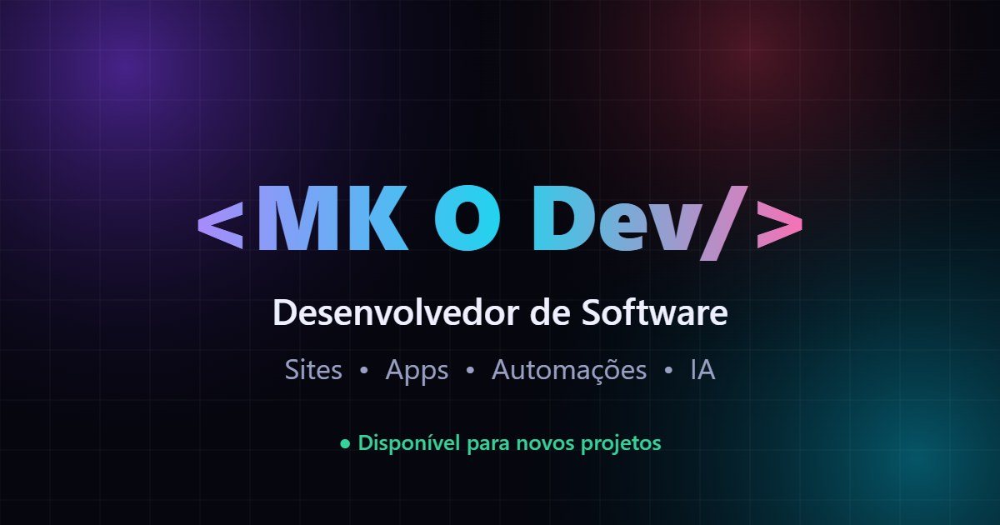

<!-- MKBRAION-POLISH:START -->

# Mkbraion.Github.Io

**Portfólio pessoal de desenvolvimento de software com projetos full-stack, back-end, mobile, APIs, inteligência artificial e soluções web.**

 

**Stack / tópicos:** ``artificial-intelligence`` · ``css`` · ``developer-portfolio`` · ``frontend`` · ``github-pages`` · ``html`` · ``javascript`` · ``portfolio`` · ``software-engineering`` · ``vercel`` · ``web-development`` · ``whatsapp``

> Projeto mantido por [@mkbraion](https://github.com/mkbraion).
<!-- MKBRAION-POLISH:END -->

# 🌐 MK O Dev — Portfólio

Portfólio pessoal para apresentar meus estudos e projetos em desenvolvimento web, back-end, aplicativos, bancos de dados e integrações.

## ✨ Destaques

- 🎨 **Identidade visual** — interface escura usando a paleta Black, Obsidian, Maroon, Crimson e Deep Crimson
- 🧭 **Navegação por abas** com rolagem suave e aba ativa automática
- 🎓 **Certificados** com visualização em tela cheia
- 📨 **Formulário de contato** integrado (recebo os dados por email) + atalho direto pro WhatsApp
- 📱 **Responsivo** — feito pensando primeiro no celular
- ⚡ **Zero dependências** — HTML, CSS e JavaScript puros, num único arquivo

## 🚀 Deploy

Publicado com **GitHub Pages** via **GitHub Actions**: todo push na `main` entra no ar automaticamente em ~1 minuto.
